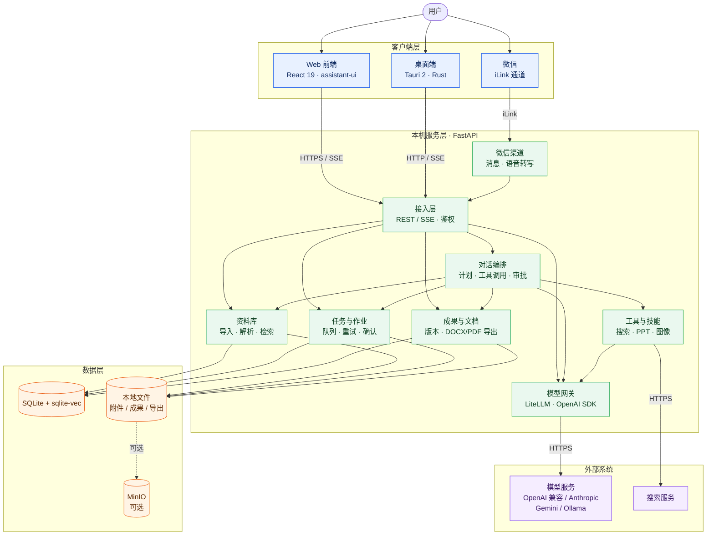

<div align="center">
  

# 团团 · 智能工作伙伴

**理解你的想法，帮你把事情做好。**

[](https://github.com/Xiaolang-d3/TuanTuan/actions/workflows/ci.yml)
[](LICENSE)
[](https://github.com/Xiaolang-d3/TuanTuan/community)

</div>

团团是一个能够执行任务的智能体。

## 项目架构



## 技术栈

- **前端**：React 19、TypeScript、Vite、Vitest、Playwright；聊天界面基于 assistant-ui
- **后端**：Python 3.11+、FastAPI、Uvicorn、Pydantic；模型接入统一走 LiteLLM 与 OpenAI SDK
- **桌面端**：Tauri 2、Rust；在 [独立仓库](https://github.com/Xiaolang-d3/TuanTuan-Desktop)维护，使用固定版本的本仓库前后端
- **数据与存储**：SQLite、sqlite-vec，可选 MinIO
- **评测**：Promptfoo

## 项目结构

```text
TuanTuan/
├── backend/             # FastAPI 服务
│   ├── app/             # 对话编排、资料库、任务与模型适配
│   └── tests/           # 后端测试
├── frontend/            # React 前端
│   ├── src/             # 页面、组件与状态
│   ├── e2e/             # Playwright 端到端测试
│   └── public/          # 静态资源
├── evals/               # 离线评测
│   ├── cases/           # 评测用例
│   └── providers/       # 评测服务适配
├── scripts/             # 启动、停止、部署与文档检查脚本
└── .github/workflows/   # CI 工作流
```

## 快速开始

```bash
./scripts/dev.sh
```

本地启动前后端；配置示例见 `backend/.env.example`，停止服务使用 `./scripts/stop-dev.sh`。

### PPT 运行包

Windows 本地 PPT 使用独立运行包，默认位置为 `backend/data/ppt-runtime`；如果设置了 `TUANTUAN_DATA_DIR`，则使用该数据目录下的 `ppt-runtime`。也可以通过 `TUANTUAN_PPT_RUNTIME` 指定其他位置。新安装需要用 `backend/scripts/build_ppt_runtime.py` 准备运行包。

从旧版升级时，将原 `tmp/ppt-runtime` 完整复制到新的默认位置；如果曾显式配置 `TUANTUAN_PPT_RUNTIME`，还需将其更新为新位置。重启后端并确认 PPT 可用后，再清理旧目录。

## 参与贡献

- [贡献指南](CONTRIBUTING.md) · [变更记录](CHANGELOG.md) · [安全政策](SECURITY.md)
- [问题反馈与功能建议](https://github.com/Xiaolang-d3/TuanTuan/issues/new/choose)

## 许可证

[MIT License](LICENSE)
