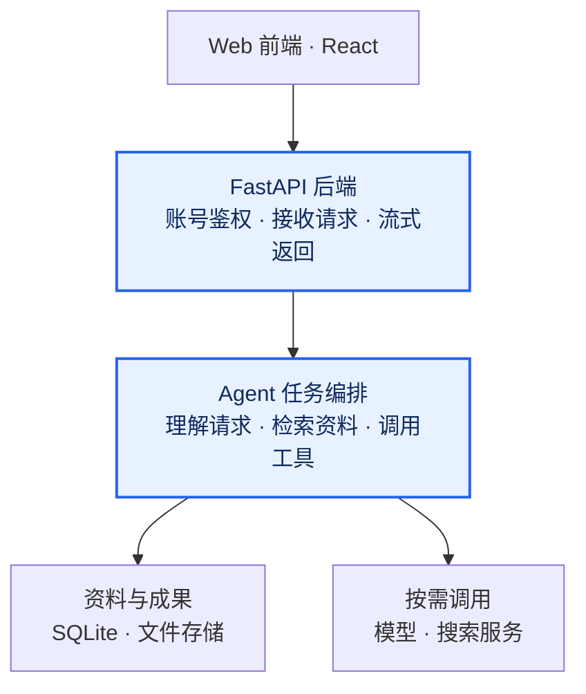

<div align="center">
  

# 团团 · 智能工作伙伴

**理解你的想法，帮你把事情做好。**

[](https://github.com/Xiaolang-d3/TuanTuan/actions/workflows/ci.yml)
[](LICENSE)
[](https://github.com/Xiaolang-d3/TuanTuan/community)

</div>

团团是一个能够执行任务的智能体。

## 项目架构



用户从 Web 发起请求，Agent 按需读取资料、调用模型和工具，再返回回答或生成文档、PPT、图片等成果。

## 技术栈

- **前端**：React 19、TypeScript、Vite、Vitest、Playwright；聊天界面基于 assistant-ui
- **后端**：Python 3.11+、FastAPI、Uvicorn、Pydantic；模型接入统一走 LiteLLM 与 OpenAI SDK
- **桌面端**：Tauri 2、Rust；在 [独立仓库](https://github.com/Xiaolang-d3/TuanTuan-Desktop)维护，使用固定版本的本仓库前后端
- **数据与存储**：SQLite、sqlite-vec，可选 MinIO
- **测试**：pytest（含 Agent 离线评测）、Vitest、Playwright

## 项目结构

```text
TuanTuan/
├── .github/             # GitHub 协作与自动化
│   ├── workflows/       # CI、CD 和版本发布
│   └── skills/          # 部署维护手册
├── backend/             # FastAPI 与业务逻辑
│   ├── app/
│   ├── tests/
│   │   └── eval_cases/  # Agent 离线评测用例，随 pytest 运行
│   └── scripts/         # 后端依赖安装、检查和构建工具
├── frontend/            # React 前端
│   ├── src/
│   ├── public/
│   └── e2e/             # Playwright 浏览器验收
└── scripts/             # 本地启动、停止入口与 CI/CD 辅助脚本
```

## 快速开始

```bash
./scripts/dev.sh
```

本地启动前后端；配置示例见 [`backend/.env.example`](backend/.env.example)，停止服务使用 `./scripts/stop-dev.sh`。本地启动不需要 Docker；使用可选 MinIO 时，按配置示例启动 [Compose 配置](backend/docker-compose.minio.yml)。生产发布和恢复参见[部署维护手册](.github/skills/tuantuan-deploy/SKILL.md)。

## 参与贡献

- [贡献指南](CONTRIBUTING.md) · [变更记录](CHANGELOG.md) · [安全政策](SECURITY.md)
- [问题反馈与功能建议](https://github.com/Xiaolang-d3/TuanTuan/issues/new/choose)

## 许可证

[MIT License](LICENSE)
